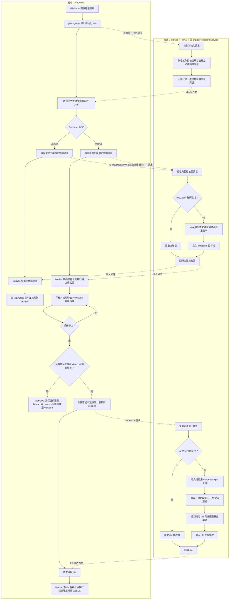

# 靜態圖片渲染流程

## 1. 文件目的

本文件定義 Tiefsee 靜態圖片從檔案來源到畫面輸出的處理流程，明確區分前端 WebView 與後端 HTTP API／`ImageProcessingService` 的工作，並說明 Canvas 與 WebGL 的載入、縮放、裁切、暫存及失敗處理方式。

本文件描述系統運作方式，不是施工階段清單。GIF、影片、剪裁匯出及其他媒體流程不在此處改寫。

## 2. 核心原則

- `FileShow.openImage()` 依設定選擇 Canvas 或 WebGL 路徑。`Tiefseeview` 不在舊載入 API 內暗中切換 Renderer。
- 縮放、平移、旋轉、鏡像與 DPI 狀態由既有 Controller 管理。Renderer 讀取 ViewState，不另外實作互動模型。
- Canvas 模式由後端產生並回傳完整縮放圖片，前端 Canvas 再裁切、縮放；WebGL 大圖模式不得要求瀏覽器完整解碼原始超大圖。
- WebGL 大圖使用低解析整圖預覽支援即時操作；停止操作後，若預覽層已足以覆蓋 viewport 輸出倍率，前端以 WebGPU Lanczos3 將保留的預覽 bitmap 重採樣至 viewport。若倍率不足，才向後端請求可視 tile。
- 圖片層級縮放、圖塊裁切、最後輸出縮放是不同步驟，必須依輸出倍率與濾鏡需求明確選擇，不能把低解析預覽當成最終畫質來源。
- 所有可重建的處理結果都是暫存快取。刪除快取不得影響原圖，也不得讓圖片無法重新顯示。

## 3. 元件責任與執行位置

| 執行位置 | 元件 | 責任 |
| --- | --- | --- |
| 前端 | `FileShow.openImage()` | 判斷動畫／靜態圖片，依設定選擇 Canvas 或 WebGL；WebGL 初始化失敗時決定是否回退 Canvas |
| 前端 | `Tiefseeview` 與 Controller | 管理縮放、平移、旋轉、鏡像、DPI 和 ViewState；將狀態通知 Renderer |
| 前端主執行緒 | ImageSource | 協調後端請求與 Worker、取消及合併重複請求；回傳 bitmap 後將資源所有權交給 Renderer |
| 前端 Worker | WebGL 靜態圖 Image Worker | 執行區域／tile 的 `fetch`、Blob 讀取與 `createImageBitmap`；以 transferable `ImageBitmap` 回傳，不操作 DOM 或 WebGL context |
| 前端 | Canvas Renderer | 載入一張完整縮放圖片，依 ViewState 在 Canvas 上裁切和縮放 |
| 前端主執行緒 | WebGL Renderer | 接收單一 tile 的 bitmap、上傳成 GPU 貼圖並關閉 bitmap；依 ViewState 繪製固定 viewport，維持有界 GPU LRU；保留目前預覽 bitmap 供閒置 Lanczos 使用 |
| 前端主執行緒 | WebGPU Lanczos Renderer | 停止操作後，將足以覆蓋輸出倍率的預覽 bitmap 以 Lanczos3 重採樣到 viewport backing-buffer，並顯示在 WebGL 預覽上方；WebGPU 不可用或來源倍率不足時維持 WebGL |
| 後端 | HTTP API | 接收前端的初始化、完整縮放圖或 tile 請求；驗證路徑、座標、層級與請求大小 |
| 後端 | `ImageProcessingService` | 依圖片格式建立 canonical vips 來源，產生完整縮放預覽或指定層級的 tile |
| 後端 | vips 來源／層級快取 | 在有限記憶體內保留 vips 來源及延遲處理的解析度層級 |
| 後端 | 暫存清理服務 | 依容量和最近使用情況清理可重建的完整預覽檔與 tile 檔 |

## 4. 整體資料流

以下用泳道標出每個工作由哪一端執行。HTTP 回應是前後端交接點；圖片縮放、磁碟暫存、裁切、解碼和繪製分別標在實際執行的一端。



## 5. Canvas 模式：載入完整縮放圖，再由前端裁切

此模式包含一項後端工作和兩項前端工作。後端產生的是「整張縮放圖」；Canvas 不會要求後端裁出目前視窗。

1. **前端選擇來源倍率：**`FileShow.openImage()` 呼叫 `getImgData()`，取得圖片尺寸及候選縮放 URL。候選 URL 描述不同倍率，不代表後端已經預先產生所有倍率檔案。
2. **前端請求完整縮放圖：**Canvas 路徑載入選定倍率的 URL；若圖片目前沒有可用的指定倍率，瀏覽器透過 HTTP API 向後端要求該倍率的完整圖片。
3. **後端查找完整圖快取：**`ImageProcessingService` 先檢查 `ImgZoom` 暫存目錄。命中時讀取該檔；未命中時由 vips 對完整來源圖執行第一次縮放，將完整結果寫入暫存檔，再回傳給前端。
4. **前端解碼整張結果：**瀏覽器將回應解碼成一張完整縮放圖片。即使原圖非常寬，這一步仍需把該倍率的整張圖片放入前端影像資源。
5. **前端 Canvas 繪製：**Canvas Renderer 根據 Controller 提供的 ViewState，從已解碼的完整縮放圖片裁切當前可視範圍，再縮放到 viewport。

例如來源倍率級距為 `0.9`，前端要求 `0.9 × 0.9 = 0.81` 時，後端輸出原圖 81% 的完整縮放圖；前端 Canvas 再把該圖裁切並縮放到目前畫面所需大小。後端完整圖快取可重用第一次 vips 縮放結果，但無法避免前端完整解碼該縮放圖，也不會消除 Canvas 第二次取樣造成的畫質差異。

## 6. WebGL 模式：整圖預覽加後端可視 tile

### 6.1 初始化 canonical 來源

1. **前端：**`FileShow.openImage()` 明確選擇 WebGL，呼叫圖片初始化 API，取得 Renderer 使用的方向校正寬高、檔案版本與 vips 處理類型。
2. **後端：**`ImageProcessingService` 依格式設定選擇原始檔或既有轉檔產物。必要時先進行格式轉換、方向校正或色彩處理，建立後續縮放與切圖共用的 canonical 來源。
3. **後端：**在有限記憶體中重用 vips 來源影像及已建立的延遲層級物件。vips 層級不等於已存到磁碟的完整縮小圖片；只有被請求的圖塊會被求值及輸出。
4. **前端：**以後端回報的校正尺寸作為唯一座標基準，建立 ImageSource、WebGL Renderer 與固定大小的 viewport canvas。

### 6.2 開啟時與操作中的預覽

1. **前端：**依預覽像素預算選擇一個整圖縮放倍率，呼叫現有完整縮放圖片 API。
2. **後端：**檢查 `ImgZoom` 完整預覽快取；未命中時由 vips 縮放整張來源圖片並寫入暫存檔，之後回傳完整預覽圖。
3. **前端 Worker：**解碼完整預覽圖並把 `ImageBitmap` 傳給主執行緒。**前端主執行緒：**分割成 GPU 貼圖並分批上傳至 WebGL。這裡傳送的是受預算限制的預覽，不是完整解析度超大圖。
4. **前端：**拖曳、滾輪縮放、旋轉或鏡像時，Controller 更新 ViewState。WebGL Renderer 立即依圖片座標轉換重繪貼圖，使用 Mipmap／即時 GPU 取樣維持互動，不呼叫後端重新縮放整張圖。

### 6.3 操作停止後的高品質輸出

1. **前端：**停止操作 180 ms 後，以最新 ViewState、DPI 和 viewport backing-buffer 尺寸計算目標輸出倍率。
2. **前端：**若目前完整預覽層的解析度足以覆蓋目標倍率，WebGL Renderer 保留該預覽的 `ImageBitmap`；WebGPU Lanczos Renderer 將它上傳為來源 texture，依逆向 ViewState 對每個 viewport 輸出像素執行 Lanczos3 取樣，輸出到獨立的 viewport 大小 WebGPU canvas。銳化設定大於 0 時，只在這次閒置更新的輸出 shader 套用柔化與銳化，不加入拖曳、縮放或旋轉時的即時繪圖。結果準備完成且仍符合最新 ViewState 後，Renderer 在同一個 JavaScript 工作內以 `visibility` 隱藏 WebGL 預覽並顯示 Lanczos canvas。兩層互斥顯示，避免透明圖片的 alpha 被重複合成；使用者再次移動、縮放、旋轉、鏡像或 viewport 改變時同步切回 WebGL 預覽。canvas 保持已排版與相同尺寸，切換時不分開排程兩次顯示狀態更新，也不使用淡入淡出。
3. **前端銳化：**若來源倍率不足、可視 tile 已載入，或 Lanczos 因裝置限制而略過，Renderer 先完成當前 WebGL viewport 繪圖，再將該畫面交給 WebGPU 銳化 pass；輸出仍放在 Lanczos canvas，完成後才與 WebGL 層互斥切換。這段處理只在閒置後執行，使用者恢復操作時立即回到 WebGL 即時畫面。
4. **前端降級：**若 WebGPU 不可用、viewport 超出裝置 texture 上限或 GPU 計算失敗，隱藏高品質／銳化 canvas 並保留 WebGL Mipmap／tile 畫面。Lanczos 略過時仍可嘗試單純銳化 viewport；兩者都不可用時則維持未銳化的 WebGL 畫面。

### 6.4 viewport canvas 的 backing 與 CSS 尺寸

WebGL 預覽 canvas 與 WebGPU Lanczos 輸出 canvas 使用相同尺寸映射，避免瀏覽器再將 backing buffer 拉伸到另一個 CSS 尺寸：

1. **前端 Renderer：**以 viewport CSS 尺寸乘上 `devicePixelRatio`，四捨五入取得 canvas backing 寬高：`backingWidth = round(viewportWidthCss × DPR)`，高度同理。
2. **前端 Renderer：**依 backing 寬高除以 DPR 設定 canvas 的 CSS 寬高：`canvasWidthCss = backingWidth / DPR`，高度同理。結果可以是小數 CSS pixel；不得改成固定整數，也不得以 `width: 100%`／`height: 100%` 讓排版尺寸覆蓋此映射。
3. **前端 CSS：**canvas 固定定位在 viewport 左上角，CSS 尺寸只由 Renderer 設定。WebGL 即時畫面及 WebGPU Lanczos 高品質畫面使用完全相同的 backing-to-CSS 尺寸。

例如 DPR 為 1.5、backing 寬度為 1529 pixels 時，CSS 寬度應為約 `1019.33px`。CSS 寬度若設成 `1019px`，會讓 backing buffer 在最終合成時再次縮放；實際測試中，將 Lanczos canvas 寬度由 `1019px` 改為 `1019.5px` 後畫面恢復清晰，之後以 backing 寬度除以 DPR 計算小數 CSS 尺寸，在不同螢幕縮放比例下均確認清晰。像素對齊的依據是 backing 尺寸與 DPR 的映射，不是 CSS 寬高必須為整數。

這個 Lanczos pass 目前使用已解碼的完整預覽層，不會為其額外呼叫後端，也不會解碼原圖；預覽 bitmap 在目前靜態圖片 Renderer 生命週期內保留一份，切換來源或 dispose 時關閉。較大倍率造成預覽來源不足時，Lanczos pass 不會把不足解析度的來源放大冒充高品質結果。

「讀取原圖 100%」在此流程表示後端可以從原始解析度來源擷取 viewport 需要的 tile，不表示前端完整載入 100% 整張大圖。當顯示倍率低於 100% 時，前端也可要求合適的較低解析度層級，避免傳送超出 viewport 取樣需求的像素。

### 6.5 以 50% 檢視、跨越 4 塊 tile 為例

假設目前採用 256 × 256 像素的 tile，50% 顯示使用 `level = 1`（`levelScale = 1/2`），反算並擴張濾鏡邊界後的可視來源矩形落在該層級中央 2 欄、2 列 tile 內：

1. **前端計算索引：**將可視來源矩形換算到 level 1 座標。若矩形為 `(left, top, right, bottom)`，相交 tile 範圍為：

   ```text
   firstTileX = floor(left / 256)
   lastTileX  = floor((right - 1) / 256)
   firstTileY = floor(top / 256)
   lastTileY  = floor((bottom - 1) / 256)
   ```

   本例的範圍是 `tileX = 1..2`、`tileY = 1..2`，共 4 塊。若濾鏡支援邊界或預取範圍跨出這 4 塊，索引範圍就包含額外相鄰 tile。

2. **前端逐塊請求：**前端只為目前需要且快取未命中的 tile 發送請求。每個請求帶有來源識別資訊（路徑／檔案版本／vips 處理類型）、`level`、`x` 和 `y`；`x`、`y` 是該層級的 tile 索引。本例是 4 個 tile 請求：`(level=1, x=1, y=1)`、`(1, 2, 1)`、`(1, 1, 2)`、`(1, 2, 2)`。請求可並行執行，但同時工作的數量有上限。網路快取或 ImageSource 命中時，不重複要求相同 tile。

3. **後端按請求產生：**每個請求先以相同來源鍵、層級和 tile 座標查磁碟 tile 快取。命中就直接回傳該 tile；未命中才載入／重用 vips 來源，取得 level 1 的延遲縮放影像，對該 tile 對應的矩形執行 `Crop`，編碼並寫入這一塊 tile 的暫存檔後回傳。

4. **不預先切完整層級：**後端不會因為使用者進入 50% 縮放，就先把整張 50% 圖縮好、再一次切成全部 tile。第一次只計算本例要求的 4 塊；之後移到尚未看過的區域時才計算那些 tile。回到已看過的區域則直接命中磁碟或前端快取。

5. **前端上傳與繪製：**Renderer 依 `(level, tileX, tileY)` 將 tile bitmap 上傳為 texture，並依原圖座標繪製。停手後高品質路徑跨 tile 取樣時，請求須含濾鏡支援邊界；不得先把數個 tile 合成成未設上限的大 bitmap。

tile API 可採一個 HTTP GET 對應一塊 tile，例如：

```text
GET /api/images/vips/tile?path={encodedPath}&LastWriteTimeUtc={fileVersion}&vipsType={type}&level=1&x=1&y=1
```

回應是一張 tile 圖片，邊界 tile 的實際寬高可小於標準 tile 尺寸。也可在後續以一個批次請求傳多個座標，但後端仍逐塊查快取、只生成缺少的 tile。首版使用單塊請求時，前端需限制並行數並合併重複請求。

## 7. vips 層級與圖塊

- `displayScale` 定義為「viewport backing-buffer 實際輸出像素／canonical 原圖像素」，已包含 DPI。由圖片像素到 viewport CSS pixel 的 ViewState 線性轉換乘上 backing-buffer／CSS pixel 比例後，取最大奇異值作為選層用的 `displayScale`，納入旋轉及鏡像；`levelScale` 定義為「該 vips 層級像素／canonical 原圖像素」。兩者必須使用同一座標方向與尺寸基準。
- 金字塔層級是來源座標系的解析度版本；level 0 為 canonical 原圖，較高 level 代表較低解析度。每層必須提供精確寬高或明確縮放比例。
- 高品質路徑選擇 `levelScale >= displayScale` 的最低解析度層級，也就是足以提供目標輸出解析度、但不會無故多取更高解析度的層級；最後由選定的高品質路徑輸出到 viewport backing-buffer 尺寸。若沒有符合條件的層級，使用最高解析度 level 0，並接受超過原圖倍率時無法增加真實細節。記憶體壓力時優先保留可視 tile、淘汰遠端 tile 或維持預覽；不得默默改用低於 `displayScale` 的來源層級並將其當成高品質結果。
- 例如畫面需要原圖的 10%（`displayScale = 0.10`），層級比例是 `1、1/2、1/4、1/8、1/16……` 時，選 `1/8 = 12.5%`。若目前完整預覽已達到或超過目標倍率，使用保留的預覽 bitmap 以 WebGPU Lanczos3 縮到 10% viewport；若預覽不足，則取目前可視範圍與預取邊界相交的 tile。此時現行 tile 畫面仍由 WebGL 取樣，不代表已套用 Lanczos3；兩條路徑都不要求完整解碼 100% 原圖。
- vips 的縮放層級以延遲影像運算建立，取圖時只求值圖塊所需的來源範圍；不可在首次開啟時同步產生所有整圖層級。
- tile 的切分尺寸是來源層級像素，與螢幕 CSS pixel、DPI 或 GPU texture 尺寸分開定義。tile 尺寸及並行數可調整，不是 ImageSource 合約的座標單位。
- vips 輸出 tile 時須包含濾鏡運算需要的來源邊界，或由請求端額外載入鄰接像素。相鄰 tile 直接繪製或供濾鏡取樣時都不可留下可見接縫。
- 當邊界 tile 超出圖片尺寸時，後端回傳裁切後的有效寬高；不得以空白像素冒充原圖內容。
- tile API 應驗證 level、tile 座標、來源尺寸及單次輸出上限；取消或過期請求不得持續佔用無界的工作佇列。

## 8. 暫存與快取

系統分開管理完整預覽圖、vips 來源影像和區域圖塊：

| 快取 | 內容 | 生命週期與用途 |
| --- | --- | --- |
| 完整縮放預覽快取 | 舊 Canvas 路徑及 WebGL 互動預覽使用的縮放整圖 | 沿用圖片縮放快取；由現有暫存清理政策淘汰 |
| vips 來源／層級快取 | canonical 來源及延遲建立的 vips 層級物件 | 記憶體內有限數量；來源切換、檔案失效或資源壓力時釋放 |
| 區域 tile 輸出快取 | 編碼後的 vips 圖塊 | 寫入專用、可刪除的暫存快取；依容量和最近使用時間淘汰 |
| 前端預覽 bitmap | WebGL Renderer 保留一份目前完整預覽 ImageBitmap，供閒置 Lanczos 重採樣重用 | 每張靜態圖最多保留目前預覽一份；新來源預覽完成並切換畫面時，釋放前一來源；Renderer dispose 時關閉 |
| GPU 貼圖 | WebGL 互動預覽／可視 tile，以及 WebGPU Lanczos 來源與 viewport 輸出 | WebGL 維持有界 texture LRU；WebGPU Lanczos 只保留目前來源與輸出 texture；新來源首幀切換後釋放前一來源，Renderer dispose 時釋放 |

tile 快取鍵必須包含來源指紋（正規化路徑、檔案大小及最後修改時間等）、解碼／方向／色彩處理變體、層級、tile 座標、tile 尺寸與輸出格式版本。來源或處理規則改變時，不得誤用舊圖塊。

前端解碼記憶體不能只用 tile 數量估算：RGBA bitmap 約每像素 4 bytes，還要計入瀏覽器解碼暫存、GPU texture、濾鏡 gutter 與同時處理中的 tile。Worker 併發、待上傳佇列及 GPU LRU 都必須受位元組預算限制。

不預先將每個層級的完整圖片都寫入磁碟。只在請求實際圖塊時產生輸出並放入有限容量的 tile 暫存快取。快取是效能最佳化而非資料來源：檔案被清除、損毀或版本不符時，後端必須能重新產生。暫存清理服務需要遞迴或依快取索引淘汰 tile，並避免 tile 數量無上限地累積。

## 9. 非同步、取消與資源釋放

- 每次來源更換與高品質視窗更新都帶有 generation／request id；只有仍屬於最新世代的結果可以顯示。
- 新的縮放或平移使舊區域不再需要時，取消未完成的 HTTP 請求與後續解碼工作。已完成且有效的 tile 可留在有界快取中。
- Worker 使用 request id／來源世代處理取消；`AbortController` 中止未完成的 HTTP 請求。`createImageBitmap` 解碼不保證可中止，過期解碼結果完成後必須關閉且不可提交。Worker 尚未 transfer 的 bitmap 由 Worker 關閉；tile bitmap transfer 成功後由 Renderer 上傳或丟棄時關閉。當前完整預覽 bitmap 由 WebGL Renderer 保留一份，切換來源或 dispose 時關閉。
- Worker 只負責圖片請求及解碼；WebGL context 仍由主執行緒持有，texture 上傳以 `requestAnimationFrame` 分批並獨立量測。若此處仍造成長時間卡頓，再評估 Worker WebGL／`OffscreenCanvas`，不可假設 Worker 自動消除 GPU 上傳停頓。
- ImageSource 不快取已交出的 CPU bitmap；Renderer 僅額外保留目前完整預覽 bitmap，供閒置 Lanczos 重採樣；tile bitmap 上傳後立即關閉。GPU texture 及預覽 bitmap 都由 Renderer 管理並在來源切換或 dispose 時釋放。
- ImageSource 回傳給 Renderer 的 bitmap 是一次性交接，不可繼續把同一 `ImageBitmap` 放在多請求共用的快取；同 tile 的未完成請求由 ImageSource 合併，已完成結果由有界 GPU texture LRU 重用。後端也須合併相同 tile 的並發 cache miss，避免重複執行 vips。
- 高品質輸出完成前保留目前預覽；成功後原子替換顯示層。失敗時繼續顯示預覽並記錄錯誤。
- WebGL 的銳化只作用於閒置後的 viewport 輸出；可用 Lanczos 時與重採樣合併執行，否則對已合成的 WebGL 預覽／tile 畫面執行銳化 pass。它不參與互動中 WebGL 繪圖。
- WebGL 切換靜態圖片時，保留目前已呈現的 WebGL／Lanczos 畫面，直到新來源的預覽 texture 上傳完成並繪出第一幀，再切換顯示層並釋放舊來源資源。這段短暫重疊會同時占用新舊預覽貼圖；未成功載入新預覽時，沿用既有錯誤回退流程。
- Worker 負責關閉尚未 transfer 的 bitmap；transfer 給 Renderer 後，由 Renderer 在上傳或丟棄時關閉 tile bitmap，並刪除自己建立的 WebGL texture、buffer、program 及 WebGPU texture。唯一例外是目前完整預覽 bitmap，WebGL Renderer 保留至來源切換或 dispose，以供閒置 Lanczos 重採樣。ImageSource 負責取消與去重請求；不得在 transfer 後重用已交出的 bitmap。
- 開啟新圖片、切換 Renderer、離開圖片檢視或 WebView 關閉時，都必須取消過期請求並釋放對應資源。

## 10. 格式、色彩與方向

- ImageSource 的尺寸、vips 金字塔及 tile 必須採相同方向校正結果。含 EXIF Orientation 的 JPEG 等格式，不可混用「瀏覽器已自動旋轉」和「後端未旋轉」的座標。
- RAW 依使用者設定選擇內嵌縮圖或完整解碼結果；tile 必須從與預覽相同的處理版本產生。
- ICC、CMYK、HDR、透明通道及特殊格式沿用既有 vips／magick／WPF 等解碼政策。不能只因 WebGL 可建立 texture 就假設顏色正確。
- tile 編碼格式必須保留來源需要的透明度與色彩品質。不可為了快取大小，在未定義品質政策下對文字、線稿或透明圖使用有損輸出。
- 動畫圖片不進入此靜態 tile 流程；影片維持既有 video 路徑。

## 11. 匯出與相容性

WebGL 顯示路徑不自動改寫 `getCanvasBlob()`、Base64、圖片搜尋或剪裁匯出。這些功能繼續使用既有 Canvas 匯出流程，直到另行定義並驗收 GPU 輸出能力。

目前 WebGL 的完整 Canvas 匯出仍會要求 1 倍來源圖；為避免匯出時重新解碼超大原圖，來源超過 1,600 萬像素時回傳不可用結果。這是完整 Canvas 匯出的限制，不影響 WebGL 顯示時按需載入 tile；若要支援超大圖原尺寸匯出，需另做 tile 合成或串流輸出流程。

Canvas 與 WebGL 由呼叫端明確選擇。WebGL 不可用、ImageSource 不支援區域來源或初始化失敗時，由 `FileShow.openImage()` 決定是否回退 Canvas。WebGL 內部的 Mipmap 預覽降級與整個 Renderer 回退是不同層級的處理：前者仍留在 WebGL 路徑，後者才重新載入舊 Canvas 路徑。

## 12. 驗收觀察點

- 在圖片縮放超過預覽層級後，網路請求應為可視區 tile，來源層級應符合 viewport 的實際輸出倍率；不得持續只顯示低解析整圖。
- 拖曳與滾輪操作時不等待高品質計算；停止操作後才出現細節更清楚的結果。
- 平移、旋轉及鏡像後，tile 仍對齊原圖；tile 邊界無縫，畫面外或圖片外沒有錯誤填色。
- 超寬大圖不得完整解碼到瀏覽器；載入的來源像素量應與可視範圍及預取邊界相稱。
- Worker 解碼期間 UI 仍可回應輸入；快速取消不能留下過期畫面或未釋放 bitmap。texture 上傳與解碼需分開量測。
- 連續縮放時舊請求不能覆蓋新結果；清除快取後仍可重新產生畫面。
- 分別確認 Canvas 舊模式、WebGL Mipmap 預覽、預覽層足夠時的 WebGPU Lanczos3、WebGPU 不可用時的回退、圖片格式處理及 GPU／來源資源釋放。預覽不足而改用 tile 的路徑目前仍由 WebGL Mipmap 顯示，需另行驗收其畫質。

